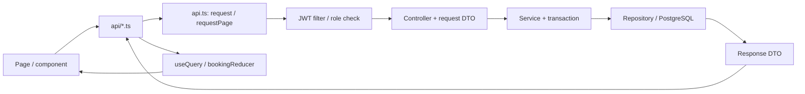

# Code walkthrough: Cinema Management Software

Ngày đối chiếu source: 25/11/2026. Tài liệu mô tả working tree trên `feature/frontend`, gồm cả phần chưa commit. Đây là bản đồ đọc code và contract input/output; trạng thái nghiệm thu được ghi trong [checkpoint G5](../testing/g5-validation-2026-11-23.md) và [hướng dẫn kiểm thử](../testing/frontend.md).

## Thứ tự đọc

1. [Frontend: khởi động, dữ liệu và từng màn hình](frontend.md).
2. [Backend: nghiệp vụ, transaction và API](backend.md).
3. [API contracts](../ui-ux/frontend-contracts.md) để xem các trường frontend dùng.
4. [Audit 27 màn](../testing/g5-validation-2026-11-23.md) để đối chiếu C01–C09, S01–S09, M01–M09.
5. [Drive alignment hardening](../decisions/008-drive-alignment-hardening.md) for current saleability, snapshots, audit and VietQR behavior.

## Đường đi của một thao tác

Frontend có ba entry point nhưng dùng chung implementation ở `frontend/shared/src`. Role quyết định router và UI; backend vẫn xác thực quyền, chủ sở hữu và trạng thái ở mỗi request. API dùng tiền do server tính và thời gian server trả về; việc khóa nút trên UI chỉ giúp thao tác đúng.

## Các khái niệm cần phân biệt

| Khái niệm | Ý nghĩa và nơi sở hữu dữ liệu |
|---|---|
| Seat vật lý | Hàng, số, loại, cặp Sweetbox thuộc phòng; quản lý bởi `SeatService`/`SweetboxService` |
| Showtime seat | Tồn ghế theo một suất, trạng thái AVAILABLE/HELD/BOOKED; độc lập giữa các suất |
| Hold | Nhóm ghế được giữ tạm cho đúng phiên đăng nhập, có hạn và token; chưa phải vé |
| Booking | Đơn có snapshot giá ghế/F&B; PENDING chưa có vé phát hành |
| Payment | Ghi nhận thu tiền; CASH, VIETQR hoặc VNPAY; chỉ xác nhận hợp lệ mới finalize |
| Ticket | Mã vé/QR từng ghế sau thanh toán; VALID → USED hoặc CANCELLED |
| Refund | Hoàn tiền vé đã chọn, có approval ràng buộc; không hoàn F&B và không hồi kho |
| Availability F&B | Số lượng có thể bán tại lúc đọc; không phải giữ hàng, checkout kiểm tra lại |

## Quy ước input/output

- Request body là JSON; query phân trang `page` bắt đầu từ 0. Backend giới hạn `size` theo từng tài nguyên.
- Thành công thông thường: `{ "data": ... }`; danh sách phân trang thật: `{ "data": { "items": [...], "page": 0, "size": 20, "totalElements": 32, "totalPages": 2 } }`.
- Frontend chuyển danh sách về `{data: T[], meta: PageMeta}`. Một số endpoint trả mảng không phân trang; adapter chỉ xử lý các shape đã hỗ trợ.
- Lỗi nghiệp vụ đi qua `ApiError(status, code, message, details)`. `details` phục vụ lỗi từng trường; lỗi mạng/timeout có `status=0` và kết quả ghi có thể chưa rõ.
- Ngày nghiệp vụ theo `Asia/Ho_Chi_Minh`. Ngày lịch sử nhập kho đổi thành biên instant `+07:00`; báo cáo gửi ngày `YYYY-MM-DD` để backend dựng kỳ.
- Token đăng nhập, PIN và approval chỉ tồn tại trong bộ nhớ frontend. Checkout chỉ lưu ID booking vào URL/sessionStorage để đọc lại sau đăng nhập, không lưu token giữ ghế.

## Ví dụ xuyên suốt

Customer chọn suất và ghế A1 → `holdsApi.hold` trả token/hạn giữ → `bookingsApi.create` gửi token, suất và giỏ F&B → server trả Booking PENDING với tổng tiền. `plannedSeats` dùng để hiển thị đơn dự kiến, không dựng QR từ dữ liệu đó. Customer lấy URL VNPay; return URL chỉ đọc trạng thái. Khi IPN hợp lệ đã commit thanh toán, frontend đọc lại booking/ticket rồi `TicketView` mới hiển thị QR từng vé.

Trong POS, Staff thu cash hoặc xác nhận đã nhận VietQR. Nếu mất response thanh toán, UI đọc lại booking trước khi cho thao tác tiếp. Với hoàn vé, retry dùng nguyên approval token và payload; backend trả refund đã ghi thay vì hoàn tiền lần nữa.

## Kiểm tra khi thay code

Đổi DTO phải rà đồng thời adapter, `types.ts`, fixture mock và test contract. Đổi trạng thái booking/payment phải rà reducer, checkout recovery, history và ticket rendering. Đổi quy tắc thời gian phải có test biên với clock backend; không chứng minh bằng việc chờ đồng hồ trên UI.

Các file walkthrough liên kết source trực tiếp để đọc chi tiết; ví dụ có ID minh họa không phải dữ liệu cố định của database. Bằng chứng mock, integration PostgreSQL và live browser có phạm vi khác nhau, không thay thế cho nhau.
