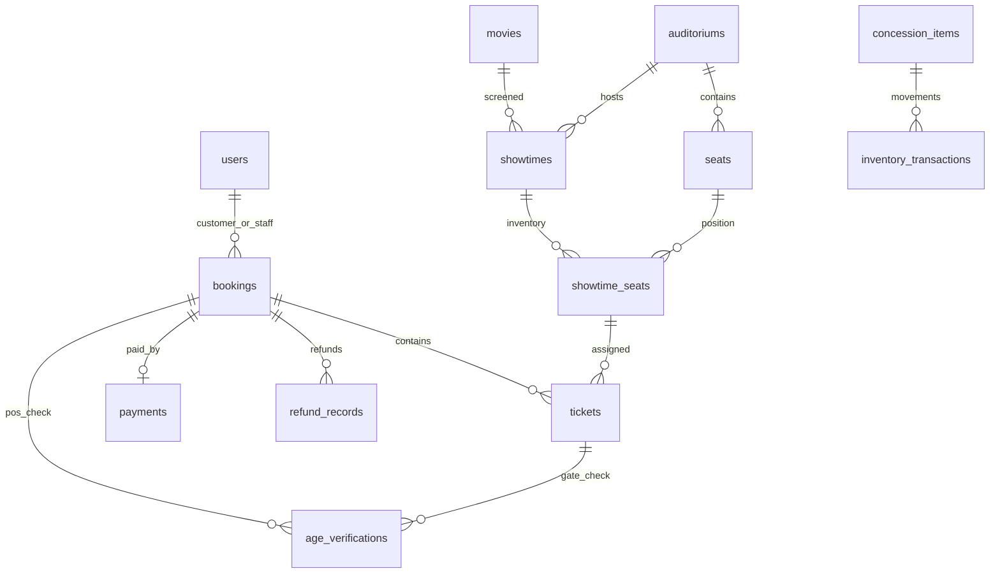

# Foundation schema handoff

The source G3 schema is preserved in V1 with two deliberate adaptations: no destructive schema reset, and absolute timestamps use TIMESTAMPTZ. V2 adds requirement gaps. V3 seeds business prices. Flyway records checksums; append new migrations after sharing these versions.

| Area | Foundation additions / contract |
|---|---|
| Users | User ID/username/email/phone unique; normalized identities; created_at/updated_at, nullable manager_pin_hash; security_version defaults 0 |
| Token revocation | revoked_access_tokens(token_id PK, expires_at); expiry index, cleanup after expiry |
| Portal dispatch | V4 auth_transfers stores SHA-256 code hash, user/role/security version/expiry; single successful redemption under row lock; no plaintext token/code persisted |
| Movies | description, genre, country, language, director, poster, trailer; positive duration |
| Auditoriums | is_active; positive total_seats |
| Seats | positive seat number, prevent self-pair/duplicate pair target; service must still validate same room, adjacency, symmetry, SWEETBOX types |
| Showtime | auditorium/start/end index; positive time range and nonnegative base_price; concurrency-safe conflict check belongs to Showtime service |
| F&B inventory | inventory_transactions with signed quantity, before/after, manager, note, type, server timestamp; restock history indexes |
| Age | bookings.age_confirmed_at for online declaration; age_verifications for POS Booking / Gate Ticket, staff and timestamp |
| Tickets | Existing VALID/USED/CANCELLED enum and unique active-ticket index retained; final USED workflow to be implemented in Ticket module |
| Payment | GATEWAY_ONLINE enum retained; booking channel and payment paid_at already present, no duplicate fields |
| Prices | Single base 70,000 plus room/seat/time surcharge; WEEKEND_OR_AFTER_18H must be evaluated once |

Core relations:

No valid paid fixtures are claimed in Foundation. Don't seed booked seats without corresponding paid Booking/Payment/Ticket. Don't reuse cancelled-ticket fixtures that leave seats BOOKED. Use BigDecimal for amounts and Instant for persistence time in later entities. Use current business timezone explicitly when converting instants into dates/18:00 price boundaries.

The generated migration does not enforce every cross-table business rule. Showtime-seat room membership, Sweetbox pairs, ownership/channel, role-specific audit, checkout atomicity, payment callbacks and refunds require the responsible service's validation/locking/transactions. An SQL FK alone cannot establish these rules.
